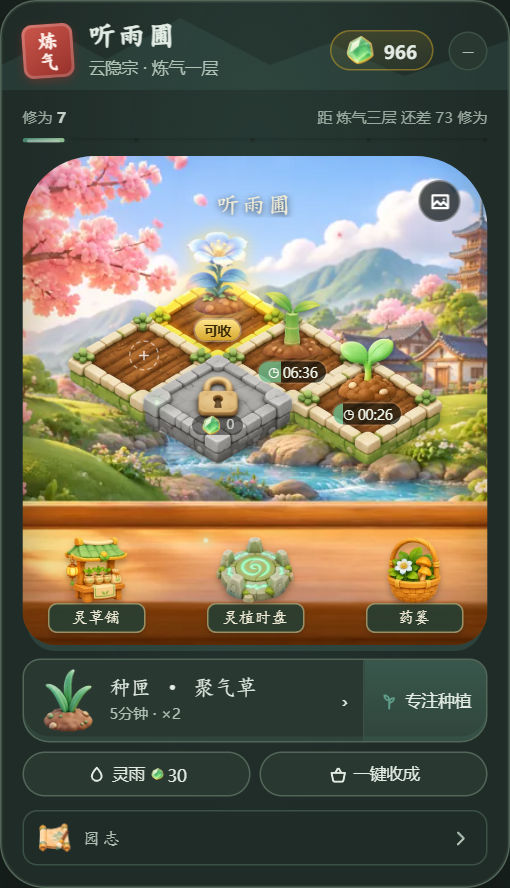

# 灵草药园 · lingcao-garden

DSH 悬浮种植插件。token → 灵石 → 买种 / 种十二种灵草 / 收成卖药 → 修为与破境开田。单机、本地存档、零模型请求。



## AI 安装契约

```yaml
plugin:
  id: lingcao-garden
  package: "@local/lingcao-garden"
  version: 0.1.0
  repo: https://github.com/muyifc/lingcao-garden
  kind: dsh-bundle
  root: .
  host: index.js
  client: client.js
  patch: cordis.patch.yml
  assets: assets/
install:
  - git clone https://github.com/muyifc/lingcao-garden.git
  - DSH Plugins > Add plugin > select repo root
  - enable; reload page
install_alt: "install_bundle(target=<repo root>)"
verify:
  test: node --test test/host.test.mjs test/client.test.mjs   # 114 pass
  assets: node scripts/check_focus_assets.mjs                # 48/48
state: "$DSH_HOME/lingcao-garden/state.json"
requirements:
  dsh: desktop 0.2.x
  node: ">=18"
  deps: none
license: MIT
notes:
  - no npm install / no build step
  - do not use `dsh plugin add` (old CLI vs desktop kernel)
```

## 人读部分

- **安装**：`git clone` 后，DSH 桌面端 **Plugins → Add plugin** 选仓库根目录；启用并刷新页面。
- **更新**：`git pull --ff-only` → Plugins 页停用再启用药园 → 刷新。
- **存档**：`%USERPROFILE%\.dsh\lingcao-garden\state.json`，不随仓库同步。
- **开发**：`npm test` / `npm run check`；玩法与素材说明在 `docs/FOCUS-PLANTS.md`。
- **License**：MIT。
